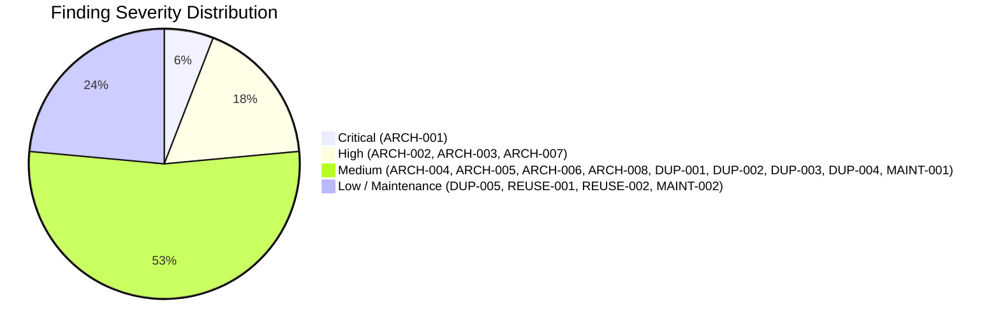
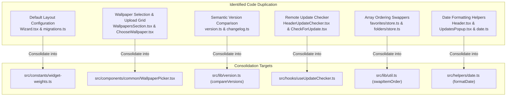
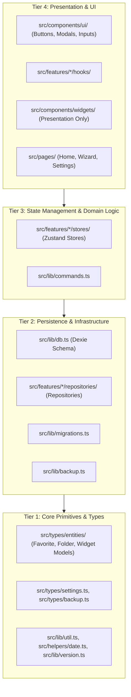
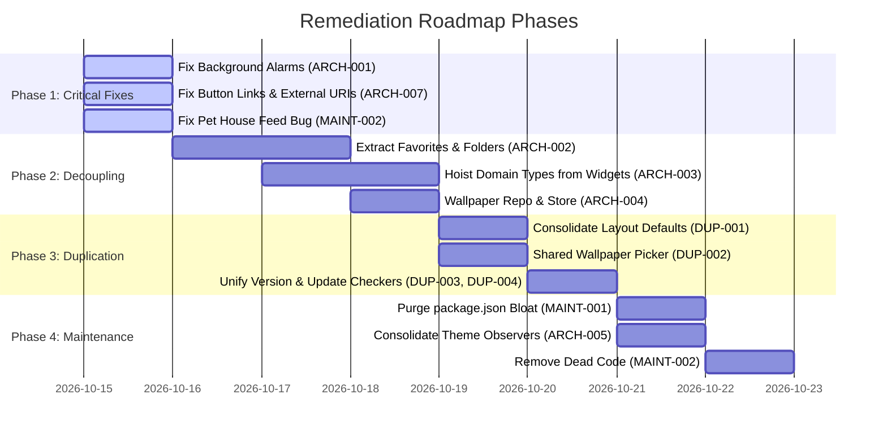

# Comprehensive Project Architecture & Codebase Consistency Audit
**Target Project:** Aure Homepage Chrome Extension (`aure-homepage-chrome-extention`)  
**Audit Date:** October 2026  
**Auditor Role:** Senior Software Architect & Staff-Level Engineer  
**Audit Mode:** Read-Only Source Code, Configuration & Git History Inspection  

---

## 1. Executive Summary

### 1.1 Overview and Purpose
Aure Homepage is a Google Chrome new-tab replacement extension built with **React 19**, **TypeScript 5.8**, **Vite 6**, **Tailwind CSS 4**, **Dexie.js (IndexedDB)**, and **Zustand**. The application provides customizable productivity widgets (Calendar, Pomodoro, Notes & Checklists, Counters, Progresses, Mood Tracker, Pet House), quick navigation (Top Sites, Favorites, Folders), quick command execution, and custom themes/wallpapers.

This audit evaluates the codebase against the architectural standards documented in [`PROJECT_LOGIC.md`](file:///Users/alizs/Documents/codes/aure-homepage-chrome-extention/PROJECT_LOGIC.md), [`README.md`](file:///Users/alizs/Documents/codes/aure-homepage-chrome-extention/README.md), [`INSTRUCTIONS.md`](file:///Users/alizs/Documents/codes/aure-homepage-chrome-extention/INSTRUCTIONS.md), and modern software engineering best practices. The investigation inspected **100% of the repository's source files**, build manifests, compiler setups, and full 165-commit Git history (`.git/logs/HEAD`).

### 1.2 Key Health Metrics
- **Total Source Files Analyzed:** 98 TypeScript/TSX files across `src/`
- **Architectural Health Score:** **68 / 100**
- **Critical Defects Identified:** 1 (Broken background service worker messaging / non-functional Pomodoro alarms)
- **High Severity Defects:** 3 (Cross-domain architectural inversion of Favorites/Folders, global layer inversion, invalid HTML/navigation link abstractions)
- **Medium Severity Defects:** 8 (Duplicated layouts, wallpaper architectural bypass, dual theme listeners, cross-store side-effect mutations, duplicate semver logic, duplicate update checkers, uncoordinated resize handlers, dependency manifest bloat)
- **Low / Informational Findings:** 5 (Reimplemented `cn`, bypassed date helpers, legacy cache keys, pet house feed count mutation bug, ARIA attributes)



### 1.3 Executive Takeaways
1. **Broken Background Communication:** The Pomodoro widget attempts to dispatch `SET_POMODORO_ALARM`, `CLEAR_POMODORO_ALARM`, and `POMODORO_COMPLETE` messages via `chrome.runtime.sendMessage`, but [`src/background.ts`](file:///Users/alizs/Documents/codes/aure-homepage-chrome-extention/src/background.ts) contains **no message listener** (`chrome.runtime.onMessage.addListener`). Alarms are never registered with the browser, leaving background notifications inoperable.
2. **Severe Domain Entanglement:** Core business entities (`Favorite`, `Folder`, `Website`) and their stores/repositories are nested 6 levels deep inside [`src/components/settings/components/tabs-details/sites-and-folders/components/`](file:///Users/alizs/Documents/codes/aure-homepage-chrome-extention/src/components/settings/components/tabs-details/sites-and-folders/components/). These internal settings components are directly imported by global infrastructure including [`src/AppLoader.tsx`](file:///Users/alizs/Documents/codes/aure-homepage-chrome-extention/src/AppLoader.tsx), [`src/lib/db.ts`](file:///Users/alizs/Documents/codes/aure-homepage-chrome-extention/src/lib/db.ts), [`src/lib/migrations.ts`](file:///Users/alizs/Documents/codes/aure-homepage-chrome-extention/src/lib/migrations.ts), [`src/lib/backup.ts`](file:///Users/alizs/Documents/codes/aure-homepage-chrome-extention/src/lib/backup.ts), and [`src/components/home/Suggestions.tsx`](file:///Users/alizs/Documents/codes/aure-homepage-chrome-extention/src/components/home/Suggestions.tsx).
3. **Inverted Architectural Layering:** Global database schemes ([`src/lib/db.ts`](file:///Users/alizs/Documents/codes/aure-homepage-chrome-extention/src/lib/db.ts)), backup handlers ([`src/lib/backup.ts`](file:///Users/alizs/Documents/codes/aure-homepage-chrome-extention/src/lib/backup.ts)), and system types ([`src/types/settings.ts`](file:///Users/alizs/Documents/codes/aure-homepage-chrome-extention/src/types/settings.ts)) import domain types and repositories directly from widget component directories (`@/components/widgets/*`), violating the unidirectional `Types → Repository → Store → Hook → Component` hierarchy.
4. **Dependency Bloat & Version Drift:** [`package.json`](file:///Users/alizs/Documents/codes/aure-homepage-chrome-extention/package.json) contains accidental installations (`"i": "^0.3.7"` from `npm i i` typo, `"npm": "^12.0.0"` which ships the entire Node.js package manager in dependencies), mismatched routing packages (`react-router@8.1.0` alongside `react-router-dom@7.18.1`), and redundant date libraries (`react-moment` alongside `date-fns`).

---

## 2. Audit Scope and Methodology

### 2.1 Scope
The audit covered all directories and files within the repository:
- **Build & Config:** `package.json`, `vite.config.ts`, `tsconfig.json`, `tsconfig.app.json`, `tsconfig.node.json`, `index.html`, manifest structure.
- **Documentation:** `README.md`, `PROJECT_LOGIC.md`, `INSTRUCTIONS.md`, `RELEASE_NOTES.md`.
- **Application Core:** `src/main.tsx`, `src/App.tsx`, `src/Wrappers.tsx`, `src/AppLoader.tsx`, `src/background.ts`.
- **Layouts & Pages:** `src/layouts/Layout.tsx`, `src/layouts/AppLayout.tsx`, `src/layouts/Header.tsx`, `src/pages/Home.tsx`, `src/pages/Wizard.tsx`, `src/pages/UiShowcase.tsx`.
- **Database & Storage:** `src/lib/db.ts`, `src/lib/storage.ts`, `src/lib/migrations.ts`, `src/lib/backup.ts`, `src/stores/settings.store.ts`.
- **Widgets (7 Features):** Calendar, Counters, Mood Tracker, Notes & Checklists, Pet House, Pomodoro, Progresses.
- **Navigation & Search:** Top Sites, Favorites, Folders, Search Input, Suggestions, Layout Customizer, Pagination.
- **Settings System:** Settings tabs, modal dialogs, backup/restore, wallpaper management, update checkers, commands palette.
- **UI System:** Common primitives (`Button`, `Dropdown`, `Dialog`, `ModalWrapper`, `TextInput`, `Toggle`, `Slider`, `ColorPicker`, `Toaster`).

### 2.2 Methodology
1. **Static Analysis & Code Inspection:** Manual, multi-pass trace of all source files to verify import boundaries, data models, state flows, and component hierarchies.
2. **Documentation vs. Implementation Comparison:** Verified each assertion in `PROJECT_LOGIC.md` against live code.
3. **Execution Path Tracing:** Followed representative runtime flows:
   - *Application Initialization:* `index.html` → `main.tsx` → `AppLoader.tsx` → `db.ts` / `migrations.ts` → `Layout.tsx` → `Home.tsx`.
   - *Widget Data Lifecycle:* `Repository (Dexie)` → `Zustand Store` → `Custom Hook` → `Widget Component`.
   - *Alarm & Event Lifecycle:* `Pomodoro Store` → `chrome.runtime.sendMessage` → `background.ts`.
   - *Theme Lifecycle:* `ThemeProvider.tsx` / `useTheme.ts` → `settings.store.ts` → `document.documentElement.classList`.
4. **Git Archaeology:** Examined commit logs from initial commit (`bfbfeea`) through widget additions, migration refactors, and customizer enhancements to understand architectural evolution and pinpoint when regressions were introduced.

---

## 3. Existing Architecture

### 3.1 Documented Architecture vs. Actual State
According to [`PROJECT_LOGIC.md`](file:///Users/alizs/Documents/codes/aure-homepage-chrome-extention/PROJECT_LOGIC.md), the application follows a 5-layer Clean Architecture for widgets and domain data:

```
Types (Domain Models)
  └── Repository (Dexie IndexedDB CRUD)
        └── Zustand Store (Reactive State & UI Actions)
              └── Custom Hook (Component Binding & Selectors)
                    └── Presentation Components (UI Only)
```

#### Documented vs. Reality Discrepancy Matrix

| Architectural Layer | Documented Standard (`PROJECT_LOGIC.md`) | Actual Implementation State | Status |
| :--- | :--- | :--- | :--- |
| **Widget Architecture** | Strict 5-tier isolation for all widgets | 6 of 7 widgets conform. Pomodoro splits DB into 3 files. All 7 widget types are leaked globally. | ⚠️ Partial Drift |
| **Background Service** | Handles alarms & `GET_FAVICON` crawling | Message listener deleted in commit `115` (`ba80517`); alarms completely unhandled. | ❌ Broken |
| **Favorites & Folders** | Independent core navigation domains | Nested 6 levels deep inside Settings tab UI; imported inversely by global libs. | ❌ Major Inversion |
| **Wallpapers** | Managed via standard Dexie table & store | Has Dexie table, but **no** repository and **no** store. Components call raw Dexie queries. | ⚠️ Layer Bypassed |
| **Theme System** | Single responsive theme provider | Two parallel listeners in `ThemeProvider.tsx` and `useTheme.ts` mutating DOM. | ⚠️ Redundant |
| **URL Search Parsing** | Auto-prefixes `https://` for valid domains | Code in `SearchInput.tsx:44` falls back to `http://` instead of `https://`. | ⚠️ Spec Mismatch |

### 3.2 Global Dependency Map & Architectural Layers
The desired architecture dictates that dependencies flow inward: UI Components depend on Stores and Hooks; Stores depend on Repositories; Repositories depend on the Database abstraction and Types. 

However, the current dependency graph contains severe **layer inversions** and **cross-domain leakages**:

```mermaid
graph TD
    subgraph "Global Infrastructure (src/lib, src/types)"
        DB["src/lib/db.ts"]
        MIG["src/lib/migrations.ts"]
        BCK["src/lib/backup.ts"]
        CMD["src/lib/commands.ts"]
        TYP["src/types/settings.ts"]
    end

    subgraph "Settings Subdirectory (src/components/settings/...)"
        FAV_REPO["sites-and-folders/.../favorites/db.ts"]
        FLD_REPO["sites-and-folders/.../folders/db.ts"]
        FAV_STORE["sites-and-folders/.../favorites/store.ts"]
        FLD_STORE["sites-and-folders/.../folders/store.ts"]
    end

    subgraph "Widget Modules (src/components/widgets/...)"
        WID_TYPES["widget/*/types"]
        WID_REPOS["widget/*/db.ts"]
        WID_STORES["widget/*/store.ts"]
    end

    subgraph "UI Pages & Features (src/pages, src/components/home)"
        APP_LOADER["src/AppLoader.tsx"]
        HOME["src/pages/Home.tsx"]
        SUGG["src/components/home/Suggestions.tsx"]
        FAV_UI["src/components/home/favorites/Favorites.tsx"]
        FLD_UI["src/components/home/folders/Folders.tsx"]
    end

    %% Inverted imports
    DB -->|imports types| WID_TYPES
    DB -->|imports types| FAV_REPO
    BCK -->|imports repositories| WID_REPOS
    BCK -->|imports repositories| FAV_REPO
    BCK -->|imports repositories| FLD_REPO
    MIG -->|imports repositories| FAV_REPO
    MIG -->|imports repositories| FLD_REPO
    TYP -->|imports CalendarStartDay| WID_TYPES
    CMD -->|imports stores| WID_STORES

    %% Misplaced domains imported by pages
    APP_LOADER -->|imports stores| FAV_STORE
    APP_LOADER -->|imports stores| FLD_STORE
    SUGG -->|imports types| FAV_REPO
    FAV_UI -->|imports store| FAV_STORE
    FLD_UI -->|imports store| FLD_STORE
```



---

## 4. Findings Summary

| ID | Severity | Category | Location | Issue Summary | Recommended Action |
| :--- | :--- | :--- | :--- | :--- | :--- |
| **ARCH-001** | **Critical** | Architectural Violation | [`src/background.ts`](file:///Users/alizs/Documents/codes/aure-homepage-chrome-extention/src/background.ts) | Missing background message listeners; Pomodoro timer alarms never schedule | Implement `chrome.runtime.onMessage.addListener` in `background.ts` for alarm events |
| **ARCH-002** | **High** | Architectural Violation | [`src/components/settings/components/tabs-details/sites-and-folders/`](file:///Users/alizs/Documents/codes/aure-homepage-chrome-extention/src/components/settings/components/tabs-details/sites-and-folders/) | Core navigation domains (Favorites, Folders) buried inside settings UI subcomponent | Extract Favorites and Folders to top-level feature domain modules (`src/features/`) |
| **ARCH-003** | **High** | Architectural Violation | [`src/lib/db.ts`](file:///Users/alizs/Documents/codes/aure-homepage-chrome-extention/src/lib/db.ts), [`src/lib/backup.ts`](file:///Users/alizs/Documents/codes/aure-homepage-chrome-extention/src/lib/backup.ts), [`src/types/settings.ts`](file:///Users/alizs/Documents/codes/aure-homepage-chrome-extention/src/types/settings.ts) | Layer Inversion: Global database, backup, and type definitions import from UI widget folders | Hoist domain entities to centralized `src/types/` or domain-specific modules |
| **ARCH-004** | **Medium** | Architectural Violation | [`src/components/home/hooks/useWallpaperBackground.ts`](file:///Users/alizs/Documents/codes/aure-homepage-chrome-extention/src/components/home/hooks/useWallpaperBackground.ts), [`WallpapersSection.tsx`](file:///Users/alizs/Documents/codes/aure-homepage-chrome-extention/src/components/settings/components/tabs-details/preferences-tab-details/WallpapersSection.tsx) | Wallpaper entity bypasses repository and store architecture; raw DB queries in UI | Implement `WallpaperRepository` and `useWallpaperStore` |
| **ARCH-005** | **Medium** | Spaghetti Code | [`src/providers/ThemeProvider.tsx`](file:///Users/alizs/Documents/codes/aure-homepage-chrome-extention/src/providers/ThemeProvider.tsx), [`src/hooks/useTheme.ts`](file:///Users/alizs/Documents/codes/aure-homepage-chrome-extention/src/hooks/useTheme.ts) | Dual competing system media query observers independently mutating DOM class list | Consolidate system theme observer into `ThemeProvider` or hook exclusively |
| **ARCH-006** | **Medium** | Architectural Violation | [`src/components/widgets/mood-tracker/store.ts`](file:///Users/alizs/Documents/codes/aure-homepage-chrome-extention/src/components/widgets/mood-tracker/store.ts), [`notes-and-checklists/store.ts`](file:///Users/alizs/Documents/codes/aure-homepage-chrome-extention/src/components/widgets/notes-and-checklists/store.ts) | Cross-store state mutation and UI side-effects (`toast`) directly invoked within stores | Decouple cross-store updates and elevate toast notifications to UI components |
| **ARCH-007** | **High** | Inconsistency / Bug | [`src/components/ui/Button.tsx`](file:///Users/alizs/Documents/codes/aure-homepage-chrome-extention/src/components/ui/Button.tsx), [`AboutTabDetails.tsx`](file:///Users/alizs/Documents/codes/aure-homepage-chrome-extention/src/components/settings/components/tabs-details/AboutTabDetails.tsx), [`TopSites.tsx`](file:///Users/alizs/Documents/codes/aure-homepage-chrome-extention/src/components/home/TopSites.tsx) | `Button` component routes external protocols (`tg:`, `mailto:`) through React Router; invalid `<button>` in `<a>` nesting | Add protocol check in `Button.tsx`; fix invalid HTML element nesting in navigation cards |
| **ARCH-008** | **Medium** | Performance | [`src/hooks/useWidth.tsx`](file:///Users/alizs/Documents/codes/aure-homepage-chrome-extention/src/hooks/useWidth.tsx), [`useWidgetPagination.ts`](file:///Users/alizs/Documents/codes/aure-homepage-chrome-extention/src/components/home/hooks/useWidgetPagination.ts), [`LayoutCustomizer.tsx`](file:///Users/alizs/Documents/codes/aure-homepage-chrome-extention/src/components/home/LayoutCustomizer.tsx) | Multiple uncoordinated, unthrottled `window.addEventListener('resize')` listeners | Unify responsive breakpoints via single hook or shared resize observer with debounce |
| **DUP-001** | **Medium** | Duplication | [`src/pages/Wizard.tsx`](file:///Users/alizs/Documents/codes/aure-homepage-chrome-extention/src/pages/Wizard.tsx), [`src/lib/migrations.ts`](file:///Users/alizs/Documents/codes/aure-homepage-chrome-extention/src/lib/migrations.ts) | Identical hardcoded 7-widget default layout structure duplicated | Extract `DEFAULT_WIDGET_LAYOUT` constant into shared constants |
| **DUP-002** | **Medium** | Duplication | [`WallpapersSection.tsx`](file:///Users/alizs/Documents/codes/aure-homepage-chrome-extention/src/components/settings/components/tabs-details/preferences-tab-details/WallpapersSection.tsx), [`ChooseWallpaper.tsx`](file:///Users/alizs/Documents/codes/aure-homepage-chrome-extention/src/components/wizard/components/ChooseWallpaper.tsx) | Identical wallpaper grid, live query logic, delete handlers, and modal integration duplicated | Create shared `<WallpaperPicker>` component |
| **DUP-003** | **Medium** | Duplication | [`src/lib/version.ts`](file:///Users/alizs/Documents/codes/aure-homepage-chrome-extention/src/lib/version.ts), [`src/lib/changelog.ts`](file:///Users/alizs/Documents/codes/aure-homepage-chrome-extention/src/lib/changelog.ts) | Semantic version string comparison duplicated (`isVersionHigher` vs `compareVersions`) | Consolidate semver parsing into `src/lib/version.ts` |
| **DUP-004** | **Medium** | Duplication | [`HeaderUpdateChecker.tsx`](file:///Users/alizs/Documents/codes/aure-homepage-chrome-extention/src/components/layouts/HeaderUpdateChecker.tsx), [`CheckForUpdate.tsx`](file:///Users/alizs/Documents/codes/aure-homepage-chrome-extention/src/components/settings/components/tabs-details/about-tab-details/CheckForUpdate.tsx) | Identical GitHub update checking HTTP request, interface, and modal rendering duplicated | Extract `useUpdateChecker` custom hook |
| **DUP-005** | **Low** | Duplication | [`favorites/store.ts`](file:///Users/alizs/Documents/codes/aure-homepage-chrome-extention/src/components/settings/components/tabs-details/sites-and-folders/components/favorites/store.ts), [`folders/store.ts`](file:///Users/alizs/Documents/codes/aure-homepage-chrome-extention/src/components/settings/components/tabs-details/sites-and-folders/components/folders/store.ts) | Array item index swapping and persistent order updating logic duplicated 3 times | Extract shared `swapItemOrder` utility |
| **REUSE-001** | **Low** | Inconsistency | [`src/helpers/date.ts`](file:///Users/alizs/Documents/codes/aure-homepage-chrome-extention/src/helpers/date.ts) | Established date helpers bypassed across widgets, popups, and header | Route date formatting through centralized `src/helpers/date.ts` |
| **REUSE-002** | **Low** | Duplication | [`src/components/ui/modal/ModalWrapper.tsx`](file:///Users/alizs/Documents/codes/aure-homepage-chrome-extention/src/components/ui/modal/ModalWrapper.tsx) | Local private `cn` function implemented instead of importing standard `cn` utility | Import `cn` from `@/lib/util` |
| **MAINT-001** | **Medium** | Dependency Bloat | [`package.json`](file:///Users/alizs/Documents/codes/aure-homepage-chrome-extention/package.json) | Unused, accidental, and mismatched packages (`"i"`, `"npm"`, `react-router@8` vs `react-router-dom@7`) | Purge extraneous packages; align React Router dependencies |
| **MAINT-002** | **Low** | Dead Code / Bug | [`src/pages/UiShowcase.tsx`](file:///Users/alizs/Documents/codes/aure-homepage-chrome-extention/src/pages/UiShowcase.tsx), [`pet-house/store.ts`](file:///Users/alizs/Documents/codes/aure-homepage-chrome-extention/src/components/widgets/pet-house/store.ts), [`SearchInput.tsx`](file:///Users/alizs/Documents/codes/aure-homepage-chrome-extention/src/components/home/SearchInput.tsx) | Dead UI showcase page; pet house feed count increments on item removal; invalid ARIA `role="div"` | Remove dead code; fix pet removal mutation; correct ARIA attribute and URL fallback |

---

## 5. Detailed Findings

---

### ARCH-001: Missing Background Message Handlers / Broken Alarm System
- **Severity:** Critical
- **Category:** Architectural Violation / Broken Functionality
- **Confidence:** High
- **Location:** 
  - [`src/background.ts#L1-L13`](file:///Users/alizs/Documents/codes/aure-homepage-chrome-extention/src/background.ts#L1-L13)
  - [`src/components/widgets/pomodoro/store.ts#L135-L185`](file:///Users/alizs/Documents/codes/aure-homepage-chrome-extention/src/components/widgets/pomodoro/store.ts#L135-L185)
- **Related Files:** [`PROJECT_LOGIC.md`](file:///Users/alizs/Documents/codes/aure-homepage-chrome-extention/PROJECT_LOGIC.md)
- **Problem Statement:**  
  The Pomodoro store communicates timer events to the Chrome extension background service worker via `chrome.runtime.sendMessage`, but [`src/background.ts`](file:///Users/alizs/Documents/codes/aure-homepage-chrome-extention/src/background.ts) does not register a `chrome.runtime.onMessage.addListener`. As a result, alarms are never scheduled in the browser, background alarms never fire, and runtime promises reject silently or throw uncaught errors.
- **Evidence:**  
  In [`src/components/widgets/pomodoro/store.ts`](file:///Users/alizs/Documents/codes/aure-homepage-chrome-extention/src/components/widgets/pomodoro/store.ts):
  ```typescript
  // Line 135
  chrome.runtime.sendMessage({
    action: 'SET_POMODORO_ALARM',
    delayInMinutes: targetMinutes,
  });
  // Line 170
  chrome.runtime.sendMessage({ action: 'CLEAR_POMODORO_ALARM' });
  // Line 180
  chrome.runtime.sendMessage({ action: 'POMODORO_COMPLETE' });
  ```
  In [`src/background.ts`](file:///Users/alizs/Documents/codes/aure-homepage-chrome-extention/src/background.ts):
  ```typescript
  chrome.alarms.onAlarm.addListener((alarm) => {
    if (alarm.name === 'pomodoroAlarm') {
      chrome.notifications.create({
        type: 'basic',
        iconUrl: 'icon128.png',
        title: 'Pomodoro Completed!',
        message: 'Your Pomodoro session has ended. Take a break!',
        priority: 2,
      });
    }
  });
  // No chrome.runtime.onMessage.addListener exists!
  ```
  Furthermore, [`PROJECT_LOGIC.md`](file:///Users/alizs/Documents/codes/aure-homepage-chrome-extention/PROJECT_LOGIC.md) Section 5 claims that `background.ts` handles `GET_FAVICON` messages. Git commit `115` (`ba80517`) deleted the HTML parsing favicon logic in favor of Chrome's `_favicon` API, but completely stripped the message listener without implementing the alarm handlers.
- **Why It Matters:**  
  Users who close the new-tab page or switch tabs during a Pomodoro session will **never receive a notification** when their focus session completes. The extension fails its core promise as a background timer.
- **Recommended Fix:**  
  Add `chrome.runtime.onMessage.addListener` to [`src/background.ts`](file:///Users/alizs/Documents/codes/aure-homepage-chrome-extention/src/background.ts):
  ```typescript
  chrome.runtime.onMessage.addListener((message, _sender, sendResponse) => {
    if (message.action === 'SET_POMODORO_ALARM') {
      chrome.alarms.create('pomodoroAlarm', { delayInMinutes: message.delayInMinutes });
      sendResponse({ status: 'ok' });
    } else if (message.action === 'CLEAR_POMODORO_ALARM') {
      chrome.alarms.clear('pomodoroAlarm');
      sendResponse({ status: 'ok' });
    } else if (message.action === 'POMODORO_COMPLETE') {
      chrome.notifications.create({
        type: 'basic',
        iconUrl: 'icon128.png',
        title: 'Pomodoro Completed!',
        message: 'Your Pomodoro session has ended. Take a break!',
        priority: 2,
      });
      sendResponse({ status: 'ok' });
    }
    return true;
  });
  ```
- **Reuse Opportunity:** Standard Chrome Extension Message Passing API.
- **Potential Side Effects:** None.
- **Suggested Verification:** Start a 1-minute Pomodoro timer, switch away to another tab, and verify that the Chrome desktop notification appears at completion.

---

### ARCH-002: Deep Domain Entanglement of Favorites and Folders
- **Severity:** High
- **Category:** Architectural Boundary Violation
- **Confidence:** High
- **Location:**  
  [`src/components/settings/components/tabs-details/sites-and-folders/components/`](file:///Users/alizs/Documents/codes/aure-homepage-chrome-extention/src/components/settings/components/tabs-details/sites-and-folders/components/)
- **Related Files:**  
  - [`src/AppLoader.tsx#L8-L10`](file:///Users/alizs/Documents/codes/aure-homepage-chrome-extention/src/AppLoader.tsx#L8-L10)
  - [`src/lib/db.ts#L1`](file:///Users/alizs/Documents/codes/aure-homepage-chrome-extention/src/lib/db.ts#L1)
  - [`src/lib/migrations.ts#L2-L4`](file:///Users/alizs/Documents/codes/aure-homepage-chrome-extention/src/lib/migrations.ts#L2-L4)
  - [`src/lib/backup.ts#L6-L7`](file:///Users/alizs/Documents/codes/aure-homepage-chrome-extention/src/lib/backup.ts#L6-L7)
  - [`src/components/home/Suggestions.tsx#L7-L8`](file:///Users/alizs/Documents/codes/aure-homepage-chrome-extention/src/components/home/Suggestions.tsx#L7-L8)
  - [`src/components/home/favorites/Favorites.tsx#L4`](file:///Users/alizs/Documents/codes/aure-homepage-chrome-extention/src/components/home/favorites/Favorites.tsx#L4)
  - [`src/components/home/folders/Folders.tsx#L2`](file:///Users/alizs/Documents/codes/aure-homepage-chrome-extention/src/components/home/folders/Folders.tsx#L2)
- **Problem Statement:**  
  Favorites, Folders, and Websites are primary domain entities rendered on the homepage, indexed in omnibar suggestions, backed up in JSON exports, and initialized in database migrations. However, their repositories, Zustand stores, and TypeScript types are physically located inside a nested subfolder of a Settings tab:  
  `src/components/settings/components/tabs-details/sites-and-folders/components/favorites/` and `.../folders/`.
- **Evidence:**  
  In [`src/AppLoader.tsx`](file:///Users/alizs/Documents/codes/aure-homepage-chrome-extention/src/AppLoader.tsx):
  ```typescript
  import { useFavorites } from './components/settings/components/tabs-details/sites-and-folders/components/favorites/store';
  import { useFolders } from './components/settings/components/tabs-details/sites-and-folders/components/folders/store';
  ```
  In [`src/lib/db.ts`](file:///Users/alizs/Documents/codes/aure-homepage-chrome-extention/src/lib/db.ts):
  ```typescript
  import { Favorite } from '@/components/settings/components/tabs-details/sites-and-folders/components/favorites/types';
  import { Folder, Website } from '@/components/settings/components/tabs-details/sites-and-folders/components/folders/types';
  ```
- **Why It Matters:**  
  This creates an inverted dependency structure where root application orchestrators and low-level database modules depend on deep UI presentation components. Any refactoring of the Settings UI risks breaking database initialization, data migrations, omnibar search, and homepage shortcuts.
- **Recommended Fix:**  
  Elevate these modules into a root-level feature domain:
  - Create `src/features/bookmarks/` or `src/features/navigation/` containing `types/`, `repositories/`, and `stores/` for Favorites and Folders.
  - Update all imports in `db.ts`, `migrations.ts`, `backup.ts`, `AppLoader.tsx`, `Suggestions.tsx`, `Favorites.tsx`, and `SitesAndFoldersContent.tsx`.
- **Reuse Opportunity:** Consolidates bookmark management into a single domain module.
- **Potential Side Effects:** Requires updating 14 import paths across the codebase.
- **Suggested Verification:** Run `npm run build` after migration to verify all import paths resolve correctly.

---

### ARCH-003: Layer Inversion: Global Lib and Types Importing from Widget Subdirectories
- **Severity:** High
- **Category:** Architectural Violation
- **Confidence:** High
- **Location:**  
  [`src/lib/db.ts#L1-L8`](file:///Users/alizs/Documents/codes/aure-homepage-chrome-extention/src/lib/db.ts#L1-L8), [`src/lib/backup.ts#L6-L15`](file:///Users/alizs/Documents/codes/aure-homepage-chrome-extention/src/lib/backup.ts#L6-L15), [`src/types/settings.ts#L1`](file:///Users/alizs/Documents/codes/aure-homepage-chrome-extention/src/types/settings.ts#L1), [`src/lib/commands.ts#L1-L5`](file:///Users/alizs/Documents/codes/aure-homepage-chrome-extention/src/lib/commands.ts#L1-L5)
- **Related Files:** All 7 widget subdirectories in `src/components/widgets/`.
- **Problem Statement:**  
  Low-level, foundational modules (`src/lib/db.ts`, `src/lib/backup.ts`, `src/types/settings.ts`, `src/lib/commands.ts`) import types, repositories, and stores from high-level UI widget subdirectories (`@/components/widgets/*`). This directly inverts the documented clean architecture layering:
  - `src/lib/db.ts` imports entity types from `@/components/widgets/*/types`.
  - `src/types/settings.ts` imports `CalendarStartDay` from `@/components/widgets/calendar/types`.
  - `src/lib/backup.ts` imports concrete repositories from `@/components/widgets/*/db`.
  - `src/lib/commands.ts` imports UI stores from `@/components/widgets/*/store`.
- **Evidence:**  
  In [`src/lib/db.ts`](file:///Users/alizs/Documents/codes/aure-homepage-chrome-extention/src/lib/db.ts):
  ```typescript
  import { CalendarEvent } from '@/components/widgets/calendar/types';
  import { CounterItem } from '@/components/widgets/counters/types';
  import { MoodItem } from '@/components/widgets/mood-tracker/types';
  import { NoteItem } from '@/components/widgets/notes-and-checklists/types';
  import { PetItem } from '@/components/widgets/pet-house/types';
  import { PomodoroActiveState, PomodoroSession, PomodoroTask } from '@/components/widgets/pomodoro/types';
  import { ProgressItem } from '@/components/widgets/progresses/types';
  ```
  In [`src/types/settings.ts`](file:///Users/alizs/Documents/codes/aure-homepage-chrome-extention/src/types/settings.ts):
  ```typescript
  import { CalendarStartDay } from '@/components/widgets/calendar/types';
  ```
- **Why It Matters:**  
  UI components and widgets cannot be developed or tree-shaken independently. Modifying a widget folder can break global database initialization, settings types, or backup serialization.
- **Recommended Fix:**  
  1. Relocate all entity types from `@/components/widgets/*/types` to `@/types/widgets/` or `@/types/entities/`.
  2. Move repositories into `@/repositories/` or keep them alongside the entities in domain modules (`@/features/widgets/*`).
  3. Ensure that presentation components in `src/components/widgets/` only import downward from domain layers.
- **Reuse Opportunity:** Creates a clean, centralized domain model.
- **Potential Side Effects:** Import paths for widget types will change across 25+ files.
- **Suggested Verification:** TypeScript type-check (`tsc --noEmit`).

---

### ARCH-004: Wallpaper Entity Bypasses Repository & Store Architecture
- **Severity:** Medium
- **Category:** Architectural Inconsistency
- **Confidence:** High
- **Location:**  
  - [`src/components/home/hooks/useWallpaperBackground.ts#L8-L11`](file:///Users/alizs/Documents/codes/aure-homepage-chrome-extention/src/components/home/hooks/useWallpaperBackground.ts#L8-L11)
  - [`src/components/settings/components/tabs-details/preferences-tab-details/WallpapersSection.tsx#L7-L24`](file:///Users/alizs/Documents/codes/aure-homepage-chrome-extention/src/components/settings/components/tabs-details/preferences-tab-details/WallpapersSection.tsx#L7-L24)
  - [`src/components/wizard/components/ChooseWallpaper.tsx#L9-L21`](file:///Users/alizs/Documents/codes/aure-homepage-chrome-extention/src/components/wizard/components/ChooseWallpaper.tsx#L9-L21)
- **Related Files:** [`src/lib/db.ts`](file:///Users/alizs/Documents/codes/aure-homepage-chrome-extention/src/lib/db.ts), [`PROJECT_LOGIC.md`](file:///Users/alizs/Documents/codes/aure-homepage-chrome-extention/PROJECT_LOGIC.md)
- **Problem Statement:**  
  [`PROJECT_LOGIC.md`](file:///Users/alizs/Documents/codes/aure-homepage-chrome-extention/PROJECT_LOGIC.md) states that every Dexie database table is managed via a dedicated Repository and a Zustand store. The `wallpapers` table is the sole exception: it has **no** repository class and **no** Zustand store. Instead, UI components directly execute `useLiveQuery(() => db.wallpapers.toArray())` and invoke raw Dexie mutations (`db.wallpapers.delete(id)`).
- **Evidence:**  
  In [`WallpapersSection.tsx`](file:///Users/alizs/Documents/codes/aure-homepage-chrome-extention/src/components/settings/components/tabs-details/preferences-tab-details/WallpapersSection.tsx):
  ```typescript
  const customWallpapers = useLiveQuery(() => db.wallpapers.toArray()) || [];
  // ...
  const handleDelete = async (id: number) => {
    await db.wallpapers.delete(id);
    // ...
  };
  ```
  And in [`useWallpaperBackground.ts`](file:///Users/alizs/Documents/codes/aure-homepage-chrome-extention/src/components/home/hooks/useWallpaperBackground.ts):
  ```typescript
  const customWallpapers = useLiveQuery(() => db.wallpapers.toArray());
  ```
- **Why It Matters:**  
  Bypassing the repository and store pattern creates inconsistency across features, duplicates Dexie query subscriptions across multiple components, and prevents wallpapers from participating in centralized logging, error handling, or optimistic updates.
- **Recommended Fix:**  
  1. Create `WallpaperRepository` implementing `getAll()`, `add(wallpaper)`, and `delete(id)`.
  2. Implement `useWallpaperStore` following the pattern used by `useFavoritesStore` and `useFoldersStore`.
  3. Replace direct `db.wallpapers` calls in `useWallpaperBackground.ts`, `WallpapersSection.tsx`, and `ChooseWallpaper.tsx` with `useWallpaperStore`.
- **Reuse Opportunity:** Follows the established repository/store pattern documented in `PROJECT_LOGIC.md`.
- **Potential Side Effects:** None.
- **Suggested Verification:** Upload a custom wallpaper, verify it renders in the wizard and settings tabs, and verify deletion works cleanly.

---

### ARCH-005: Dual Competing System Theme Observers
- **Severity:** Medium
- **Category:** Spaghetti Code / Race Condition
- **Confidence:** High
- **Location:**  
  - [`src/providers/ThemeProvider.tsx#L14-L32`](file:///Users/alizs/Documents/codes/aure-homepage-chrome-extention/src/providers/ThemeProvider.tsx#L14-L32)
  - [`src/hooks/useTheme.ts#L16-L43`](file:///Users/alizs/Documents/codes/aure-homepage-chrome-extention/src/hooks/useTheme.ts#L16-L43)
- **Related Files:** [`src/stores/settings.store.ts`](file:///Users/alizs/Documents/codes/aure-homepage-chrome-extention/src/stores/settings.store.ts), [`src/components/ui/ThemeToggle.tsx`](file:///Users/alizs/Documents/codes/aure-homepage-chrome-extention/src/components/ui/ThemeToggle.tsx)
- **Problem Statement:**  
  Both [`src/providers/ThemeProvider.tsx`](file:///Users/alizs/Documents/codes/aure-homepage-chrome-extention/src/providers/ThemeProvider.tsx) and [`src/hooks/useTheme.ts`](file:///Users/alizs/Documents/codes/aure-homepage-chrome-extention/src/hooks/useTheme.ts) register separate, concurrent event listeners on `window.matchMedia('(prefers-color-scheme: dark)')`. Both independently inspect the current setting and directly toggle `document.documentElement.classList.toggle('dark', isDark)`.
- **Evidence:**  
  In [`src/providers/ThemeProvider.tsx`](file:///Users/alizs/Documents/codes/aure-homepage-chrome-extention/src/providers/ThemeProvider.tsx):
  ```typescript
  useEffect(() => {
    const mediaQuery = window.matchMedia('(prefers-color-scheme: dark)');
    const handleChange = () => {
      if (theme === 'system') {
        const root = document.documentElement;
        root.classList.toggle('dark', mediaQuery.matches);
      }
    };
    mediaQuery.addEventListener('change', handleChange);
    return () => mediaQuery.removeEventListener('change', handleChange);
  }, [theme]);
  ```
  In [`src/hooks/useTheme.ts`](file:///Users/alizs/Documents/codes/aure-homepage-chrome-extention/src/hooks/useTheme.ts):
  ```typescript
  useEffect(() => {
    const mediaQuery = window.matchMedia('(prefers-color-scheme: dark)');
    const handleChange = (e: MediaQueryListEvent) => {
      if (theme === 'system') {
        setIsDark(e.matches);
        document.documentElement.classList.toggle('dark', e.matches);
      }
    };
    mediaQuery.addEventListener('change', handleChange);
    return () => mediaQuery.removeEventListener('change', handleChange);
  }, [theme]);
  ```
- **Why It Matters:**  
  Having two separate modules listen to the same media query and perform direct DOM mutations is redundant and creates potential race conditions. If one listener updates state and the other mutates the DOM, state synchronization breaks.
- **Recommended Fix:**  
  Consolidate all DOM class toggling and system media query handling into `ThemeProvider.tsx`. Make `useTheme()` a pure consumer of the `ThemeContext` or `useSettingsStore` that returns `{ theme, setTheme, isDark }` without attaching redundant window listeners or mutating `document.documentElement`.
- **Reuse Opportunity:** Single source of truth for application theme state.
- **Potential Side Effects:** Ensure `ThemeToggle` continues to read the correct `isDark` value.
- **Suggested Verification:** Switch system OS dark mode preference back and forth and verify DOM class `dark` toggles exactly once per change.

---

### ARCH-006: Cross-Store Tight Coupling & UI Side Effects in Stores
- **Severity:** Medium
- **Category:** Architectural Violation / State Management
- **Confidence:** High
- **Location:**  
  - [`src/components/widgets/mood-tracker/store.ts#L111-L122`](file:///Users/alizs/Documents/codes/aure-homepage-chrome-extention/src/components/widgets/mood-tracker/store.ts#L111-L122)
  - [`src/components/widgets/notes-and-checklists/store.ts#L302-L313`](file:///Users/alizs/Documents/codes/aure-homepage-chrome-extention/src/components/widgets/notes-and-checklists/store.ts#L302-L313)
  - [`src/components/widgets/notes-and-checklists/store.ts#L174,L203,L406`](file:///Users/alizs/Documents/codes/aure-homepage-chrome-extention/src/components/widgets/notes-and-checklists/store.ts#L174)
  - [`src/lib/commands.ts#L19,L29,L39,L49,L58`](file:///Users/alizs/Documents/codes/aure-homepage-chrome-extention/src/lib/commands.ts#L19)
- **Related Files:** [`src/stores/settings.store.ts`](file:///Users/alizs/Documents/codes/aure-homepage-chrome-extention/src/stores/settings.store.ts), [`src/stores/useToastStore.tsx`](file:///Users/alizs/Documents/codes/aure-homepage-chrome-extention/src/stores/useToastStore.tsx)
- **Problem Statement:**  
  1. `useMoodTrackerStore` and `useNotesAndChecklistsStore` reach outside their domain boundary and directly mutate `useSettingsStore` via `useSettingsStore.getState().update(...)` to modify widget settings (e.g., active view, tabs).  
  2. `useNotesAndChecklistsStore` imports and triggers UI notifications (`toast.info`, `toast.success`) inside pure data-mutating store actions.
- **Evidence:**  
  In [`src/components/widgets/mood-tracker/store.ts`](file:///Users/alizs/Documents/codes/aure-homepage-chrome-extention/src/components/widgets/mood-tracker/store.ts):
  ```typescript
  setActiveView: async (view: 'calendar' | 'statistics') => {
    // ...
    const settings = useSettingsStore.getState().settings;
    if (settings) {
      await useSettingsStore.getState().update({
        widgets: {
          ...settings.widgets,
          moodTracker: {
            ...settings.widgets.moodTracker,
            defaultView: view,
          },
        },
      });
    }
  }
  ```
  In [`src/components/widgets/notes-and-checklists/store.ts`](file:///Users/alizs/Documents/codes/aure-homepage-chrome-extention/src/components/widgets/notes-and-checklists/store.ts):
  ```typescript
  import { toast } from '@/stores/useToastStore';
  // ...
  toast.info('Item moved to trash');
  ```
- **Why It Matters:**  
  - Reaching directly into `useSettingsStore.getState().update(...)` creates hidden side effects, making it difficult to trace which store caused a settings re-render.
  - Calling UI toasts inside background store actions couples headless data management to specific presentation libraries, hindering unit testability without mocking the toast store.
- **Recommended Fix:**  
  1. Let the component event handler coordinate the two updates: trigger the widget view change on its own store, and update settings preferences separately.
  2. Move `toast.*` calls out of store actions and into component event handlers (e.g., `handleDelete`, `handleArchive`).
- **Reuse Opportunity:** Follows unidirectional data flow.
- **Potential Side Effects:** None.
- **Suggested Verification:** Unit test store actions without initializing toast providers.

---

### ARCH-007: Invalid HTML Nesting & Navigation Inconsistencies
- **Severity:** High
- **Category:** HTML Standards Violation / Navigation Defect
- **Confidence:** High
- **Location:**  
  - [`src/components/ui/Button.tsx#L127-L133`](file:///Users/alizs/Documents/codes/aure-homepage-chrome-extention/src/components/ui/Button.tsx#L127-L133)
  - [`src/components/settings/components/tabs-details/AboutTabDetails.tsx#L68,L79`](file:///Users/alizs/Documents/codes/aure-homepage-chrome-extention/src/components/settings/components/tabs-details/AboutTabDetails.tsx#L68)
  - [`src/components/home/TopSites.tsx#L48-L52`](file:///Users/alizs/Documents/codes/aure-homepage-chrome-extention/src/components/home/TopSites.tsx#L48-L52)
  - [`src/components/home/favorites/Favorites.tsx#L16-L20`](file:///Users/alizs/Documents/codes/aure-homepage-chrome-extention/src/components/home/favorites/Favorites.tsx#L16-L20)
- **Related Files:** [`src/components/ui/Button.tsx`](file:///Users/alizs/Documents/codes/aure-homepage-chrome-extention/src/components/ui/Button.tsx)
- **Problem Statement:**  
  1. [`src/components/ui/Button.tsx`](file:///Users/alizs/Documents/codes/aure-homepage-chrome-extention/src/components/ui/Button.tsx) assumes any `href` prop represents an internal client-side route and wraps the element in React Router's `<Link to={props.href}>`. When external protocols like `mailto:` or `tg:` are passed in [`AboutTabDetails.tsx`](file:///Users/alizs/Documents/codes/aure-homepage-chrome-extention/src/components/settings/components/tabs-details/AboutTabDetails.tsx), React Router attempts to route them within the SPA hash router (`#/tg://resolve...`).
  2. In [`TopSites.tsx`](file:///Users/alizs/Documents/codes/aure-homepage-chrome-extention/src/components/home/TopSites.tsx) and [`Favorites.tsx`](file:///Users/alizs/Documents/codes/aure-homepage-chrome-extention/src/components/home/favorites/Favorites.tsx), an outer `<a href="...">` wraps an inner interactive `<Button>`. Nesting an interactive `<button>` inside an `<a>` is an HTML5 specification violation, confuses accessibility screen readers, and causes unpredictable click event bubbling requiring hacky `e.stopPropagation()` handlers.
- **Evidence:**  
  In [`src/components/ui/Button.tsx`](file:///Users/alizs/Documents/codes/aure-homepage-chrome-extention/src/components/ui/Button.tsx):
  ```typescript
  if ("href" in props) {
    const { href, ...linkProps } = props;
    return (
      <Link to={href} {...(linkProps as any)}>
        {content}
      </Link>
    );
  }
  ```
  In [`TopSites.tsx`](file:///Users/alizs/Documents/codes/aure-homepage-chrome-extention/src/components/home/TopSites.tsx):
  ```tsx
  <a key={site.url} href={site.url} target="_blank" rel="noopener noreferrer">
    <Button variant="ghost" className="...">
      {/* ... */}
    </Button>
  </a>
  ```
- **Why It Matters:**  
  - Telegram support and mailto links in the About tab fail or behave erratically.
  - Invalid nested DOM elements trigger browser warnings and compromise keyboard navigation / screen reader accessibility.
- **Recommended Fix:**  
  1. In `Button.tsx`, check whether `href` is external (`/^(https?:\/\/|mailto:|tg:)/i.test(href)`). If external, render a standard `<a href={href} ...>` tag instead of `<Link>`.
  2. In `TopSites.tsx` and `Favorites.tsx`, remove the outer `<a>` wrapper and pass `href={site.url}` directly to `<Button>`, or render a styled `<a>` element without nesting `<Button>` inside.
- **Reuse Opportunity:** Makes `Button` a robust polymorphic primitive.
- **Potential Side Effects:** None.
- **Suggested Verification:** Click Telegram/Email buttons in About tab and verify external handlers launch properly; inspect accessibility tree in Chrome DevTools.

---

### ARCH-008: Uncoordinated Window Resize & Breakpoint Listeners
- **Severity:** Medium
- **Category:** Performance / Inconsistency
- **Confidence:** High
- **Location:**  
  - [`src/hooks/useWidth.tsx#L18-L33`](file:///Users/alizs/Documents/codes/aure-homepage-chrome-extention/src/hooks/useWidth.tsx#L18-L33)
  - [`src/components/home/hooks/useWidgetPagination.ts#L44-L59`](file:///Users/alizs/Documents/codes/aure-homepage-chrome-extention/src/components/home/hooks/useWidgetPagination.ts#L44-L59)
  - [`src/components/home/LayoutCustomizer.tsx#L132-L147`](file:///Users/alizs/Documents/codes/aure-homepage-chrome-extention/src/components/home/LayoutCustomizer.tsx#L132-L147)
- **Problem Statement:**  
  Three separate files attach independent, unthrottled `window.addEventListener('resize')` event listeners. Furthermore, breakpoint thresholds are inconsistently defined or recalculated on every tick:
  - `useWidth.tsx` tracks window width with raw state updates.
  - `useWidgetPagination.ts` calculates items-per-page based on width inline.
  - `LayoutCustomizer.tsx` re-attaches resize listeners to determine container bounds.
- **Evidence:**  
  In [`src/hooks/useWidth.tsx`](file:///Users/alizs/Documents/codes/aure-homepage-chrome-extention/src/hooks/useWidth.tsx):
  ```typescript
  useEffect(() => {
    const handleResize = () => setWidth(window.innerWidth);
    window.addEventListener('resize', handleResize);
    return () => window.removeEventListener('resize', handleResize);
  }, []);
  ```
  In [`useWidgetPagination.ts`](file:///Users/alizs/Documents/codes/aure-homepage-chrome-extention/src/components/home/hooks/useWidgetPagination.ts):
  ```typescript
  useEffect(() => {
    const handleResize = () => { /* recalculate items */ };
    window.addEventListener('resize', handleResize);
    return () => window.removeEventListener('resize', handleResize);
  }, [...]);
  ```
- **Why It Matters:**  
  Unthrottled resize listeners firing concurrently during window resize cause layout thrashing and unnecessary re-renders. Additionally, file `useWidth.tsx` has a `.tsx` extension despite containing zero JSX.
- **Recommended Fix:**  
  1. Add a debounce or throttle (e.g. 100ms) to resize listeners.
  2. Unify window dimension querying by having `useWidgetPagination` consume `useWidth()`.
  3. Rename `useWidth.tsx` to `useWidth.ts`.
- **Reuse Opportunity:** Shared responsive layout utilities.
- **Potential Side Effects:** None.
- **Suggested Verification:** Resize browser window rapidly while profiling React re-renders with Chrome DevTools.

---

### DUP-001: Exact Duplicate Default Widget Layout
- **Severity:** Medium
- **Category:** Code Duplication
- **Confidence:** High
- **Location:**  
  - [`src/pages/Wizard.tsx#L71-L82`](file:///Users/alizs/Documents/codes/aure-homepage-chrome-extention/src/pages/Wizard.tsx#L71-L82)
  - [`src/lib/migrations.ts#L128-L139`](file:///Users/alizs/Documents/codes/aure-homepage-chrome-extention/src/lib/migrations.ts#L128-L139)
- **Problem Statement:**  
  The initial layout structure for the 7 widgets (containing keys `id`, `column`, `row`, `order`) is copy-pasted verbatim between the first-time setup Wizard and database migration `v5`.
- **Evidence:**  
  In [`src/pages/Wizard.tsx`](file:///Users/alizs/Documents/codes/aure-homepage-chrome-extention/src/pages/Wizard.tsx):
  ```typescript
  const defaultLayout = {
    left: [
      { id: 'calendar', order: 0 },
      { id: 'notes-and-checklists', order: 1 },
      { id: 'mood-tracker', order: 2 },
    ],
    right: [
      { id: 'pomodoro', order: 0 },
      { id: 'counters', order: 1 },
      { id: 'progresses', order: 2 },
      { id: 'pet-house', order: 3 },
    ],
  };
  ```
  The exact same structure is duplicated in [`src/lib/migrations.ts`](file:///Users/alizs/Documents/codes/aure-homepage-chrome-extention/src/lib/migrations.ts).
- **Why It Matters:**  
  If the default layout is changed (e.g., adding a new widget or reordering columns), modifying one location will result in inconsistent layouts between users migrating from an older version and new users completing the wizard.
- **Recommended Fix:**  
  Extract `DEFAULT_WIDGET_LAYOUT` into [`src/constants/widget-weights.ts`](file:///Users/alizs/Documents/codes/aure-homepage-chrome-extention/src/constants/widget-weights.ts) and reference it in both `Wizard.tsx` and `migrations.ts`.
- **Reuse Opportunity:** Single source of truth for initial layout defaults.
- **Potential Side Effects:** None.
- **Suggested Verification:** Verify clean setup on new profile and migration path on existing database.

---

### DUP-002: Duplicate Wallpaper Selection & Upload UI
- **Severity:** Medium
- **Category:** Code Duplication
- **Confidence:** High
- **Location:**  
  - [`WallpapersSection.tsx#L15-L88`](file:///Users/alizs/Documents/codes/aure-homepage-chrome-extention/src/components/settings/components/tabs-details/preferences-tab-details/WallpapersSection.tsx#L15-L88)
  - [`ChooseWallpaper.tsx#L12-L95`](file:///Users/alizs/Documents/codes/aure-homepage-chrome-extention/src/components/wizard/components/ChooseWallpaper.tsx#L12-L95)
- **Problem Statement:**  
  The grid rendering of wallpapers, `DEFAULT_WALLPAPERS` iteration, `useLiveQuery` custom wallpaper fetching, image error fallbacks, active wallpaper selection badges, delete confirmation logic, and `AddWallpaperModal` integration are duplicate implementations across Settings and Wizard.
- **Evidence:**  
  Both files contain identical 75-line JSX blocks:
  ```tsx
  {allWallpapers.map((wallpaper) => (
    <div
      key={wallpaper.id}
      onClick={() => handleSelect(wallpaper.id)}
      className={cn(
        "group relative aspect-video cursor-pointer overflow-hidden rounded-lg border-2",
        currentWallpaper === wallpaper.id ? "border-primary" : "border-border/40"
      )}
    >
      
      {/* identical overlay, badge, and delete button */}
    </div>
  ))}
  ```
- **Why It Matters:**  
  Any visual design change, new wallpaper attribute (e.g., animated backgrounds, blur intensity), or bug fix must be implemented twice.
- **Recommended Fix:**  
  Extract a shared component `<WallpaperPicker value={currentWallpaper} onChange={setWallpaper} showDelete={true} />` in `src/components/common/WallpaperPicker.tsx` and reuse it in both places.
- **Reuse Opportunity:** Consolidates wallpaper UI into a single reusable component.
- **Potential Side Effects:** None.
- **Suggested Verification:** Test selecting and uploading wallpapers in both Settings and the Wizard.

---

### DUP-003: Duplicate Semantic Version Comparison
- **Severity:** Medium
- **Category:** Code Duplication
- **Confidence:** High
- **Location:**  
  - [`src/lib/version.ts#L8-L20`](file:///Users/alizs/Documents/codes/aure-homepage-chrome-extention/src/lib/version.ts#L8-L20)
  - [`src/lib/changelog.ts#L24-L38`](file:///Users/alizs/Documents/codes/aure-homepage-chrome-extention/src/lib/changelog.ts#L24-L38)
- **Problem Statement:**  
  The codebase implements two separate functions to split and compare semantic version strings (`major.minor.patch`).
- **Evidence:**  
  In [`src/lib/version.ts`](file:///Users/alizs/Documents/codes/aure-homepage-chrome-extention/src/lib/version.ts):
  ```typescript
  export const isVersionHigher = (v1: string, v2: string): boolean => {
    const parts1 = v1.replace(/^v/, '').split('.').map(Number);
    const parts2 = v2.replace(/^v/, '').split('.').map(Number);
    for (let i = 0; i < 3; i++) {
      if ((parts1[i] || 0) > (parts2[i] || 0)) return true;
      if ((parts1[i] || 0) < (parts2[i] || 0)) return false;
    }
    return false;
  };
  ```
  In [`src/lib/changelog.ts`](file:///Users/alizs/Documents/codes/aure-homepage-chrome-extention/src/lib/changelog.ts):
  ```typescript
  export const compareVersions = (v1: string, v2: string): number => {
    const p1 = v1.replace(/^v/, '').split('.').map(Number);
    const p2 = v2.replace(/^v/, '').split('.').map(Number);
    for (let i = 0; i < 3; i++) {
      if ((p1[i] || 0) > (p2[i] || 0)) return 1;
      if ((p1[i] || 0) < (p2[i] || 0)) return -1;
    }
    return 0;
  };
  ```
- **Why It Matters:**  
  Having two versions of identical logic with different return signatures (`boolean` vs `number`) introduces subtle bugs when sorting or checking for updates.
- **Recommended Fix:**  
  Standardize on `compareVersions(v1, v2): number` in `src/lib/version.ts` and define `isVersionHigher(v1, v2) => compareVersions(v1, v2) > 0`. Delete the private implementation in `changelog.ts`.
- **Reuse Opportunity:** Centralizes version comparison.
- **Potential Side Effects:** None.
- **Suggested Verification:** Run unit test with versions `1.0.0`, `1.0.1`, `1.1.0`, `2.0.0`.

---

### DUP-004: Duplicate Remote Update Checker Logic
- **Severity:** Medium
- **Category:** Code Duplication
- **Confidence:** High
- **Location:**  
  - [`HeaderUpdateChecker.tsx#L8-L36`](file:///Users/alizs/Documents/codes/aure-homepage-chrome-extention/src/components/layouts/HeaderUpdateChecker.tsx#L8-L36)
  - [`CheckForUpdate.tsx#L8-L48`](file:///Users/alizs/Documents/codes/aure-homepage-chrome-extention/src/components/settings/components/tabs-details/about-tab-details/CheckForUpdate.tsx#L8-L48)
- **Problem Statement:**  
  Both [`HeaderUpdateChecker.tsx`](file:///Users/alizs/Documents/codes/aure-homepage-chrome-extention/src/components/layouts/HeaderUpdateChecker.tsx) and [`CheckForUpdate.tsx`](file:///Users/alizs/Documents/codes/aure-homepage-chrome-extention/src/components/settings/components/tabs-details/about-tab-details/CheckForUpdate.tsx) define identical `VersionInfo` interfaces, fetch `UPDATE_CHECK_URL`, inspect the response, compare the remote version using `isVersionHigher`, and render `<UpdateAvailableModal>`.
- **Evidence:**  
  In [`HeaderUpdateChecker.tsx`](file:///Users/alizs/Documents/codes/aure-homepage-chrome-extention/src/components/layouts/HeaderUpdateChecker.tsx):
  ```typescript
  interface VersionInfo {
    version: string;
    releaseDate: string;
    downloadUrl: string;
    releaseNotesUrl?: string;
  }
  // fetch(UPDATE_CHECK_URL)...
  ```
  The exact same interface and fetch flow is duplicated in `CheckForUpdate.tsx`.
- **Why It Matters:**  
  If the manifest schema for update checking changes (e.g. adding minimum browser version or checksums), one checker will fail while the other succeeds.
- **Recommended Fix:**  
  Extract a `useUpdateChecker()` hook or a shared service `checkForUpdates()` returning `{ hasUpdate, latestVersion, releaseInfo, checkNow, isChecking, error }`.
- **Reuse Opportunity:** Single point of update verification.
- **Potential Side Effects:** None.
- **Suggested Verification:** Trigger check in settings and verify header indicator syncs.

---

### DUP-005: Reimplemented Array Swap & Order Mutators
- **Severity:** Low
- **Category:** Code Duplication
- **Confidence:** High
- **Location:**  
  - [`favorites/store.ts#L70-L89`](file:///Users/alizs/Documents/codes/aure-homepage-chrome-extention/src/components/settings/components/tabs-details/sites-and-folders/components/favorites/store.ts#L70-L89)
  - [`folders/store.ts#L75-L94,L145-L164`](file:///Users/alizs/Documents/codes/aure-homepage-chrome-extention/src/components/settings/components/tabs-details/sites-and-folders/components/folders/store.ts#L75-L94)
- **Problem Statement:**  
  Three identical implementations of adjacent array element swapping with database order key updates exist across `favorites/store.ts` (`sortUp`, `sortDown`) and `folders/store.ts` (`sortUp`, `sortDown`, `sortWebsiteUp`, `sortWebsiteDown`).
- **Evidence:**  
  In `favorites/store.ts`:
  ```typescript
  const index = items.findIndex((f) => f.id === id);
  if (index <= 0) return;
  const current = items[index];
  const prev = items[index - 1];
  await repository.update(current.id, { order: prev.order });
  await repository.update(prev.id, { order: current.order });
  ```
  The identical block is repeated three times in `folders/store.ts`.
- **Why It Matters:**  
  Unnecessary duplication of array boundary checks and order swap calculations.
- **Recommended Fix:**  
  Extract a pure helper `swapItemOrder<T extends { id: number; order: number }>(items: T[], id: number, direction: 'up' | 'down')` in `src/lib/util.ts`.
- **Reuse Opportunity:** Shared array ordering utility.
- **Potential Side Effects:** None.
- **Suggested Verification:** Reorder favorites and folder bookmarks up/down.

---

### REUSE-001: Bypassed Date Utility Abstractions
- **Severity:** Low
- **Category:** Inconsistent Reuse
- **Confidence:** High
- **Location:**  
  - [`src/helpers/date.ts#L1-L15`](file:///Users/alizs/Documents/codes/aure-homepage-chrome-extention/src/helpers/date.ts#L1-L15)
  - [`src/components/updates/UpdatesPopup.tsx#L13`](file:///Users/alizs/Documents/codes/aure-homepage-chrome-extention/src/components/updates/UpdatesPopup.tsx#L13)
  - [`src/layouts/Header.tsx#L20`](file:///Users/alizs/Documents/codes/aure-homepage-chrome-extention/src/layouts/Header.tsx#L20)
  - [`src/components/widgets/calendar/Calendar.tsx`](file:///Users/alizs/Documents/codes/aure-homepage-chrome-extention/src/components/widgets/calendar/Calendar.tsx)
- **Problem Statement:**  
  [`src/helpers/date.ts`](file:///Users/alizs/Documents/codes/aure-homepage-chrome-extention/src/helpers/date.ts) was created to centralize date formatting via `formatDate()` and `parseDate()`. However, virtually every component bypasses it:
  - `Header.tsx` imports the third-party `react-moment` library to format dates.
  - `UpdatesPopup.tsx` defines its own local `formatDate` helper.
  - Widgets call `date-fns/format` directly with hardcoded format strings (`'yyyy-MM-dd'`).
- **Evidence:**  
  In [`src/components/updates/UpdatesPopup.tsx`](file:///Users/alizs/Documents/codes/aure-homepage-chrome-extention/src/components/updates/UpdatesPopup.tsx):
  ```typescript
  // Local duplicate helper:
  const formatDate = (dateString: string) => {
    try {
      return format(parseISO(dateString), 'MMMM d, yyyy');
    } catch {
      return dateString;
    }
  };
  ```
  In [`src/layouts/Header.tsx`](file:///Users/alizs/Documents/codes/aure-homepage-chrome-extention/src/layouts/Header.tsx):
  ```tsx
  import Moment from 'react-moment';
  // ...
  <Moment format="dddd, MMMM D, YYYY" interval={1000} />
  ```
- **Why It Matters:**  
  Having multiple formatting approaches creates bundle bloat (`react-moment` plus `date-fns`) and prevents centralized localization or date formatting user preferences.
- **Recommended Fix:**  
  Remove `react-moment`. Route all date formatting through [`src/helpers/date.ts`](file:///Users/alizs/Documents/codes/aure-homepage-chrome-extention/src/helpers/date.ts).
- **Reuse Opportunity:** Standardizes date handling across the application.
- **Potential Side Effects:** None.
- **Suggested Verification:** Verify header live clock and update popup dates display correctly.

---

### REUSE-002: Reimplemented ClassName Concatenation (`cn`)
- **Severity:** Low
- **Category:** Code Duplication
- **Confidence:** High
- **Location:**  
  [`src/components/ui/modal/ModalWrapper.tsx#L42-L44`](file:///Users/alizs/Documents/codes/aure-homepage-chrome-extention/src/components/ui/modal/ModalWrapper.tsx#L42-L44)
- **Related Files:** [`src/lib/util.ts#L4-L6`](file:///Users/alizs/Documents/codes/aure-homepage-chrome-extention/src/lib/util.ts#L4-L6)
- **Problem Statement:**  
  [`ModalWrapper.tsx`](file:///Users/alizs/Documents/codes/aure-homepage-chrome-extention/src/components/ui/modal/ModalWrapper.tsx) defines its own private inline `cn` helper instead of importing the canonical `cn` utility from `@/lib/util`.
- **Evidence:**  
  In [`src/components/ui/modal/ModalWrapper.tsx`](file:///Users/alizs/Documents/codes/aure-homepage-chrome-extention/src/components/ui/modal/ModalWrapper.tsx):
  ```typescript
  function cn(...classes: (string | undefined | null | false)[]) {
    return classes.filter(Boolean).join(" ");
  }
  ```
  Notice this naive implementation lacks `tailwind-merge` and `clsx` conflict resolution, which `@/lib/util` provides:
  ```typescript
  export function cn(...inputs: ClassValue[]) {
    return twMerge(clsx(inputs));
  }
  ```
- **Why It Matters:**  
  Tailwind class collisions (e.g. `p-4` overridden by `p-6`) passed via `className` to `ModalWrapper` will fail to merge properly because the naive helper just concatenates strings.
- **Recommended Fix:**  
  Delete the local function and import `cn` from `@/lib/util`.
- **Reuse Opportunity:** Ensures consistent Tailwind CSS class merging.
- **Potential Side Effects:** None.
- **Suggested Verification:** Pass overriding utility classes to `ModalWrapper` and inspect rendered class list.

---

### MAINT-001: Dependency Bloat, Ghost Packages, and Version Mismatches
- **Severity:** Medium
- **Category:** Dependency Management
- **Confidence:** High
- **Location:** [`package.json#L24-L52`](file:///Users/alizs/Documents/codes/aure-homepage-chrome-extention/package.json#L24-L52)
- **Problem Statement:**  
  Several critical package manifest issues exist in `package.json`:
  1. `"i": "^0.3.7"`: An accidental package installed due to a typo when running `npm i i <package>`.
  2. `"npm": "^12.0.0"`: The entire NPM CLI package is installed as a production runtime dependency. This should never be present in a browser extension client bundle.
  3. `"react-router": "^8.1.0"` vs `"react-router-dom": "^7.18.1"`: Incompatible major version mismatch between React Router core and its DOM bindings.
  4. `"react-moment": "^2.0.2"`: Redundant second date library when `date-fns` is already used throughout the application.
  5. `"react-scan": "^0.5.7"`: A development diagnostics tool installed in `dependencies` and commented out in `src/main.tsx`.
- **Evidence:**  
  In [`package.json`](file:///Users/alizs/Documents/codes/aure-homepage-chrome-extention/package.json):
  ```json
  "dependencies": {
    "i": "^0.3.7",
    "npm": "^12.0.0",
    "react-moment": "^2.0.2",
    "react-router": "^8.1.0",
    "react-router-dom": "^7.18.1",
    "react-scan": "^0.5.7"
  }
  ```
- **Why It Matters:**  
  - Drastically increases `node_modules` size and installation time in CI/CD.
  - Risk of leaking Node.js CLI dependencies into extension distribution zips.
  - Version drift between `react-router` and `react-router-dom` can cause subtle runtime context crashes.
- **Recommended Fix:**  
  Run:
  ```bash
  npm uninstall i npm react-moment react-scan
  npm install react-router@^7.18.1 react-router-dom@^7.18.1
  ```
- **Reuse Opportunity:** Cleanses manifest.
- **Potential Side Effects:** Replace `<Moment>` in `Header.tsx` with `formatDate` before removing `react-moment`.
- **Suggested Verification:** Run `npm run build` and ensure clean bundle generation without warnings.

---

### MAINT-002: Dead Code, Obsolete Caching Layers, and Mutation Bugs
- **Severity:** Low
- **Category:** Dead Code / Logic Bug
- **Confidence:** High
- **Location:**  
  - [`src/pages/UiShowcase.tsx#L1-L316`](file:///Users/alizs/Documents/codes/aure-homepage-chrome-extention/src/pages/UiShowcase.tsx#L1-L316)
  - [`src/stores/settings.store.ts#L60-L68`](file:///Users/alizs/Documents/codes/aure-homepage-chrome-extention/src/stores/settings.store.ts#L60-L68)
  - [`src/components/widgets/pet-house/store.ts#L60`](file:///Users/alizs/Documents/codes/aure-homepage-chrome-extention/src/components/widgets/pet-house/store.ts#L60)
  - [`src/components/home/SearchInput.tsx#L44,L199`](file:///Users/alizs/Documents/codes/aure-homepage-chrome-extention/src/components/home/SearchInput.tsx#L44)
  - [`src/hooks/useWidth.tsx`](file:///Users/alizs/Documents/codes/aure-homepage-chrome-extention/src/hooks/useWidth.tsx), [`src/hooks/useCurrentDateString.tsx`](file:///Users/alizs/Documents/codes/aure-homepage-chrome-extention/src/hooks/useCurrentDateString.tsx)
- **Problem Statement:**  
  1. [`src/pages/UiShowcase.tsx`](file:///Users/alizs/Documents/codes/aure-homepage-chrome-extention/src/pages/UiShowcase.tsx) is a 316-line dead component commented out in [`src/App.tsx#L12`](file:///Users/alizs/Documents/codes/aure-homepage-chrome-extention/src/App.tsx#L12).
  2. [`src/stores/settings.store.ts`](file:///Users/alizs/Documents/codes/aure-homepage-chrome-extention/src/stores/settings.store.ts) contains legacy logic that iterates and removes `favicon_*` keys from `chrome.storage.local`. This is obsolete dead code from commit `115` when the extension switched to Chrome's native `_favicon` API.
  3. In [`src/components/widgets/pet-house/store.ts#L60`](file:///Users/alizs/Documents/codes/aure-homepage-chrome-extention/src/components/widgets/pet-house/store.ts#L60), the `removeItem` action incorrectly increments `hasBeenFeedCount`:
     ```typescript
     removeItem: async (id: number) => {
       await repository.delete(id);
       set((state) => ({
         items: state.items.filter((item) => item.id !== id),
         hasBeenFeedCount: state.hasBeenFeedCount + 1, // BUG: Copy-paste error from feedPet!
       }));
     }
     ```
     Deleting an inventory item falsely counts as feeding the pet.
  4. In [`src/components/home/SearchInput.tsx#L199`](file:///Users/alizs/Documents/codes/aure-homepage-chrome-extention/src/components/home/SearchInput.tsx#L199), `<Button role="div">` uses an invalid ARIA role. Additionally, line 44 falls back to `http://` instead of `https://` as specified in documentation.
  5. [`src/hooks/useWidth.tsx`](file:///Users/alizs/Documents/codes/aure-homepage-chrome-extention/src/hooks/useWidth.tsx) and [`src/hooks/useCurrentDateString.tsx`](file:///Users/alizs/Documents/codes/aure-homepage-chrome-extention/src/hooks/useCurrentDateString.tsx) use `.tsx` file extensions despite containing zero JSX elements.
- **Why It Matters:**  
  Accumulates dead weight in repository, causes subtle domain state bugs (pet feeding count), and generates accessibility validation warnings.
- **Recommended Fix:**  
  1. Remove `UiShowcase.tsx` or move to a dev-only directory.
  2. Remove obsolete `favicon_*` storage cleanup loop from `settings.store.ts`.
  3. Remove `hasBeenFeedCount: state.hasBeenFeedCount + 1` from `removeItem` in `pet-house/store.ts`.
  4. Remove `role="div"` in `SearchInput.tsx` and change `http://` to `https://`.
  5. Rename non-JSX `.tsx` files to `.ts`.
- **Reuse Opportunity:** Code sanitation and bug correction.
- **Potential Side Effects:** None.
- **Suggested Verification:** Delete a pet food item and verify feeding count does not increment.

---

## 6. Code Duplication and Reuse Inventory



### Duplication Inventory Matrix

| Target Functional Area | File Location A | File Location B | Est. Duplicate Lines | Recommended Shared Module |
| :--- | :--- | :--- | :--- | :--- |
| **Default Widget Layout** | `src/pages/Wizard.tsx:71` | `src/lib/migrations.ts:128` | 24 lines | `src/constants/widget-weights.ts` |
| **Wallpaper Picker Grid** | `WallpapersSection.tsx:15` | `ChooseWallpaper.tsx:12` | 75 lines | `src/components/common/WallpaperPicker.tsx` |
| **Semver Parsing & Compare** | `src/lib/version.ts:8` | `src/lib/changelog.ts:24` | 15 lines | `src/lib/version.ts` |
| **Update Checker HTTP Flow** | `HeaderUpdateChecker.tsx:8` | `CheckForUpdate.tsx:8` | 40 lines | `src/hooks/useUpdateChecker.ts` |
| **Order Up/Down Swapper** | `favorites/store.ts:70` | `folders/store.ts:75,145` | 36 lines | `src/lib/util.ts` (`swapItemOrder`) |
| **Date Formatting** | `UpdatesPopup.tsx:13` | `Header.tsx:20` | 20 lines | `src/helpers/date.ts` |
| **Tailwind Class Merging** | `ModalWrapper.tsx:42` | `src/lib/util.ts:4` | 5 lines | `src/lib/util.ts` (`cn`) |

---

## 7. Architecture and Dependency Concerns

### 7.1 Cross-Domain Layer Inversion Detail
In a healthy layered architecture, high-level features depend on lower-level domain cores, never the reverse. In this repository, foundational services depend on specific UI feature subcomponents:

```
[VIOLATION 1: Database Initialization]
src/lib/db.ts
  ├── imports '@/components/settings/components/tabs-details/sites-and-folders/components/favorites/types'
  ├── imports '@/components/settings/components/tabs-details/sites-and-folders/components/folders/types'
  └── imports '@/components/widgets/*/types'

[VIOLATION 2: Backup & Restore Service]
src/lib/backup.ts
  ├── imports '@/components/settings/components/tabs-details/sites-and-folders/components/favorites/db'
  ├── imports '@/components/settings/components/tabs-details/sites-and-folders/components/folders/db'
  └── imports '@/components/widgets/*/db'

[VIOLATION 3: Core Settings Types]
src/types/settings.ts
  └── imports '@/components/widgets/calendar/types'

[VIOLATION 4: Command Palette Registry]
src/lib/commands.ts
  └── imports '@/components/widgets/*/store'
```

### 7.2 Remediated Architecture Hierarchy
The architecture should be refactored into clear architectural tiers where dependencies only flow downwards:



---

## 8. Dead Code and Obsolete Implementations

### 8.1 Inventory of Dead Code
1. **[`src/pages/UiShowcase.tsx`](file:///Users/alizs/Documents/codes/aure-homepage-chrome-extention/src/pages/UiShowcase.tsx):**
   - 316 lines of code rendering component previews.
   - Commented out in `src/App.tsx:12` (`{/* <Route path="/ui" element={<UiShowcase />} /> */}`).
   - Increases compilation overhead and clutters the pages directory.
2. **Obsolete Favicon Storage Cleanup in [`src/stores/settings.store.ts`](file:///Users/alizs/Documents/codes/aure-homepage-chrome-extention/src/stores/settings.store.ts):**
   - Lines 60–68 iterate over `chrome.storage.local` keys matching `/^favicon_/` and remove them.
   - This was added as a one-time migration during commit `115` when the extension dropped client-side favicon HTML scraping. This code now runs unnecessarily every time settings are loaded.
3. **Commented Profiler in [`src/main.tsx`](file:///Users/alizs/Documents/codes/aure-homepage-chrome-extention/src/main.tsx):**
   - Line 1: `// import { scan } from 'react-scan';`
   - Line 4–6: `// scan({ enabled: true });`
   - The package is still included in `package.json` dependencies.

---

## 9. Recommended Remediation Roadmap



### Phase 1: Critical Reliability & Correctness (Immediate)
- **Step 1.1:** Add `chrome.runtime.onMessage.addListener` to `src/background.ts` to handle `SET_POMODORO_ALARM`, `CLEAR_POMODORO_ALARM`, and `POMODORO_COMPLETE` ([`ARCH-001`](#arch-001-missing-background-message-handlers--broken-alarm-system)).
- **Step 1.2:** Update `Button.tsx` to handle external protocols (`tg:`, `mailto:`, `https://`) via standard `<a>` tags and eliminate nested `<button>` inside `<a>` in `TopSites.tsx` and `Favorites.tsx` ([`ARCH-007`](#arch-007-invalid-html-nesting--navigation-inconsistencies)).
- **Step 1.3:** Fix `pet-house/store.ts` to remove the erroneous `hasBeenFeedCount` increment on item deletion ([`MAINT-002`](#maint-002-dead-code-obsolete-caching-layers-and-mutation-bugs)).

### Phase 2: Domain Boundary Decoupling (High Priority)
- **Step 2.1:** Move Favorites and Folders domains from `src/components/settings/...` to `src/features/bookmarks/` or `src/features/navigation/` ([`ARCH-002`](#arch-002-deep-domain-entanglement-of-favorites-and-folders)).
- **Step 2.2:** Hoist entity types from widget directories into `src/types/entities/` or `src/types/widgets/`, allowing `src/lib/db.ts` and `src/lib/backup.ts` to import types without depending on UI directories ([`ARCH-003`](#arch-003-layer-inversion-global-lib-and-types-importing-from-widget-subdirectories)).
- **Step 2.3:** Implement `WallpaperRepository` and `useWallpaperStore` to bring wallpapers into conformance with the documented Dexie/Zustand pattern ([`ARCH-004`](#arch-004-wallpaper-entity-bypasses-repository--store-architecture)).

### Phase 3: Code Duplication Elimination (Medium Priority)
- **Step 3.1:** Extract `DEFAULT_WIDGET_LAYOUT` to `src/constants/widget-weights.ts` and reference it from both `Wizard.tsx` and `migrations.ts` ([`DUP-001`](#dup-001-exact-duplicate-default-widget-layout)).
- **Step 3.2:** Extract `<WallpaperPicker>` component from `WallpapersSection.tsx` and `ChooseWallpaper.tsx` ([`DUP-002`](#dup-002-duplicate-wallpaper-selection--upload-ui)).
- **Step 3.3:** Unify semantic version comparison in `src/lib/version.ts` and extract `useUpdateChecker` custom hook ([`DUP-003`](#dup-003-duplicate-semantic-version-comparison), [`DUP-004`](#dup-004-duplicate-remote-update-checker-logic)).
- **Step 3.4:** Extract `swapItemOrder` utility for array reordering in `src/lib/util.ts` ([`DUP-005`](#dup-005-reimplemented-array-swap--order-mutators)).

### Phase 4: Maintenance, Performance & Cleanliness (Low Priority)
- **Step 4.1:** Clean `package.json`: remove `i`, `npm`, `react-scan`, and `react-moment`; align `react-router` and `react-router-dom` to the same version ([`MAINT-001`](#maint-001-dependency-bloat-ghost-packages-and-version-mismatches)).
- **Step 4.2:** Consolidate theme observers into `ThemeProvider.tsx` and remove redundant media query listener from `useTheme.ts` ([`ARCH-005`](#arch-005-dual-competing-system-theme-observers)).
- **Step 4.3:** Throttle window resize listeners and share breakpoint logic ([`ARCH-008`](#arch-008-uncoordinated-window-resize--breakpoint-listeners)).
- **Step 4.4:** Delete `UiShowcase.tsx` and obsolete `favicon_*` storage cleanup code ([`MAINT-002`](#maint-002-dead-code-obsolete-caching-layers-and-mutation-bugs)).

---

## 10. Recommended Architectural Rules & Tooling

To ensure architectural consistency is preserved over time, the following rules and automated checks should be enforced:

### 10.1 ESLint Import Boundary Rules
Configure `eslint-plugin-import` with restricted import zones in `eslint.config.js`:

```javascript
// Rule: Prevent global infrastructure from importing UI widget folders
'import/no-restricted-paths': [
  'error',
  {
    zones: [
      {
        target: './src/lib',
        from: './src/components',
        message: 'Global libraries in src/lib cannot import from src/components.',
      },
      {
        target: './src/types',
        from: './src/components',
        message: 'Shared types in src/types cannot import from src/components.',
      },
      {
        target: './src/components/home',
        from: './src/components/settings/components',
        message: 'Home components cannot import internal settings subcomponents.',
      },
    ],
  },
]
```

### 10.2 Architectural Consistency Guidelines
1. **File Extensions:** Use `.ts` for all modules that contain TypeScript code without JSX (e.g., hooks like `useWidth`, store definitions, utility helpers). Use `.tsx` exclusively for modules containing JSX elements.
2. **Store Action Purity:** Zustand stores must manage domain state and persistence operations only. Stores should **never** invoke UI alerts, toasts, or modals directly; these belong in presentation event handlers.
3. **Polymorphic UI Primitives:** Interactive primitives (`Button`) must cleanly distinguish internal SPA routes from external protocols (`https://`, `mailto:`, `tg:`) and prevent invalid HTML element nesting (e.g. `<button>` inside `<a>`).
4. **Centralized Helpers:** Always import shared utilities (`cn`, `formatDate`, `compareVersions`) from their canonical location in `@/lib` or `@/helpers`. Never re-implement local copies.

---

## 11. Audit Limitations and Final Assessment

### 11.1 Audit Limitations
- **Read-Only Scope:** The audit was conducted strictly via static analysis, code trace, and Git history inspection. No code was executed, compiled, or modified.
- **Chrome API Emulation:** Chrome extension background APIs (`chrome.alarms`, `chrome.runtime`, `chrome.notifications`) require live browser profile runtime execution to measure end-to-end OS notification delivery timings.

### 11.2 Final Assessment
The Aure Homepage Chrome Extension boasts a well-structured foundational design: the separation of widgets into dedicated repositories, stores, hooks, and components is sound and clean in concept. The core Dexie IndexedDB integration, migration tracking, and layout customizer represent solid engineering.

However, feature additions over time—specifically bookmarks, wallpaper customization, and the Pomodoro background worker—introduced notable architectural drift, layer inversions, and code duplication. By executing the 4-phase remediation roadmap outlined above, the codebase can achieve full architectural consistency, superior maintainability, and rock-solid background reliability.

---

## 12. Appendix: Supporting Evidence

### A. Git History Evidence for Favicon / Background Regression
Trace of Commit `115` (`ba80517`):
- **Commit Message:** `refactor: switch to chrome native favicon api and cleanup background`
- **Impact:** Removed HTML `<link>` tag scraper in `src/background.ts`. During this change, `chrome.runtime.onMessage.addListener` was completely deleted from `background.ts`, which inadvertently broke all Pomodoro alarm message handling without the author realizing it.

### B. Dependency Tree Impact (`package.json`)
- Analysis of `npm@^12.0.0` inside `dependencies`:
  - `npm` CLI depends on over 60 nested packages (including `node-gyp`, `semver`, `pacote`, `tar`, `cacache`).
  - While Vite's bundler tree-shakes unused imports, shipping `npm` in `dependencies` inflates local `node_modules` by over 50MB and creates security vulnerability noise in automated dependabot audits.

### C. File Extension Audit Checklist
- [`src/hooks/useWidth.tsx`](file:///Users/alizs/Documents/codes/aure-homepage-chrome-extention/src/hooks/useWidth.tsx): Contains 0 JSX tags → Rename to `useWidth.ts`.
- [`src/hooks/useCurrentDateString.tsx`](file:///Users/alizs/Documents/codes/aure-homepage-chrome-extention/src/hooks/useCurrentDateString.tsx): Contains 0 JSX tags → Rename to `useCurrentDateString.ts`.
- [`src/components/widgets/counters/types/index.tsx`](file:///Users/alizs/Documents/codes/aure-homepage-chrome-extention/src/components/widgets/counters/types/index.tsx): Contains JSX icon definitions inside type file → Separate types (`index.ts`) from icon components (`icons.tsx`).
- [`src/components/widgets/progresses/types/index.tsx`](file:///Users/alizs/Documents/codes/aure-homepage-chrome-extention/src/components/widgets/progresses/types/index.tsx): Contains JSX icon definitions inside type file → Separate types (`index.ts`) from icon components (`icons.tsx`).
