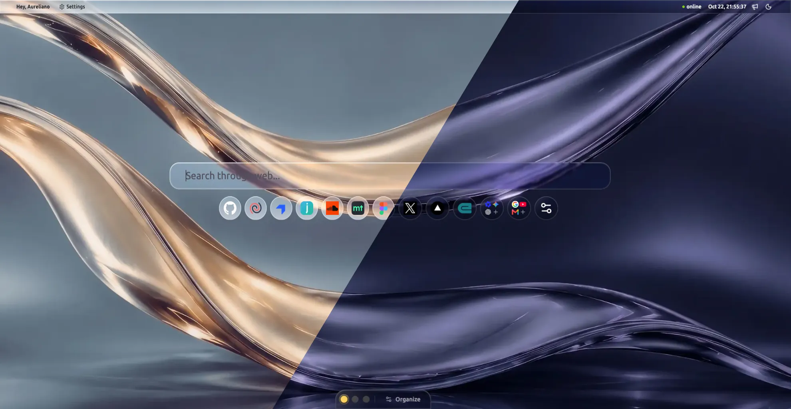

# Aure Homepage

A modern and customizable New Tab extension for **Google Chrome** and **Mozilla Firefox**, built with React, TypeScript, and Vite.

Aure Homepage replaces your browser's default new tab with a clean, fast, and privacy-friendly dashboard designed to help you stay organized and productive.

---

## Screenshot

<p align="center">
  
</p>

---

## Features

### Search

* Fast Google search
* Command support
* Search suggestions
* Direct URL navigation
* Localhost and IP address support

### Widgets

* Calendar
* Notes & Tasks
* Mood Tracker
* Pet House
* Pomodoro Timer
* Counters
* Progresses

### Sites & Folders

* Favorite Sites
* Top Sites (Chrome & Firefox)
* Custom folders
* Default Google and AI website folders
* Automatic high-resolution favicon fetching
* Search suggestions from browsing history and folder websites

### Productivity

* Pomodoro focus sessions
* Focus notifications

### Personalization

* Light, Dark themes
* Multiple accent colors
* Wallpaper support
* Curated special backgrounds
* Adjustable background blur
* Liquid Glass interface
* Configurable widgets

### Updates

* In-app release changelog
* Version history
* New release indicators

### Data

* Local-first storage
* Import and export data
* Automatic update checking
* No user data sent to external servers

---

## Installation

### Google Chrome
1. Download **`aure-homepage-chrome-v0.1.0.zip`** from the [Releases](https://github.com/alizs10/aure-homepage-chrome-extension/releases) page.
2. Extract the ZIP file.
3. Open `chrome://extensions` in your browser.
4. Enable **Developer mode** in the top-right corner.
5. Click **Load unpacked** and select the extracted folder.

### Mozilla Firefox
1. Download **`aure-homepage-firefox-v0.1.0.zip`** from the [Releases](https://github.com/alizs10/aure-homepage-chrome-extension/releases) page.
2. Extract the ZIP file.
3. Open `about:debugging#/runtime/this-firefox` in your browser.
4. Click **Load Temporary Add-on...** and select the `manifest.json` file inside the extracted folder.

---

## Updating

Download the latest ZIP for your browser from the [Releases](https://github.com/alizs10/aure-homepage-chrome-extension/releases) page and extract it over your existing installation folder, or reload the unpacked extension in your browser's extensions page (`chrome://extensions` or `about:debugging#/runtime/this-firefox`).

Your local settings, bookmarks, and widget data are stored locally and will be preserved across updates.

---

## Tech Stack

* React 19
* TypeScript
* Vite
* Tailwind CSS v4
* Zustand
* Dexie (IndexedDB)
* Framer Motion
* React Hook Form
* Zod

---

## Development

Clone the repository:

```bash
git clone https://github.com/alizs10/aure-homepage-chrome-extension.git
```

Install dependencies:

```bash
bun install
```

Start the development server:

```bash
bun run dev
```

Build the extension:

```bash
# Build for Chrome
bun run build:chrome

# Build for Firefox
bun run build:firefox

# Build for both browsers
bun run build
```

---

## Storage

Aure Homepage stores all user data locally.

* IndexedDB (Dexie) is used for widgets and user content.
* Browser Extension Storage (`storage.local`) is used for application settings.

No user data is sent to external servers.

---

## Permissions

Aure Homepage requests only the permissions required for its features across Chrome and Firefox.

### Extension Permissions

| Permission      | Browser | Purpose                                                                   |
| --------------- | ------- | ------------------------------------------------------------------------- |
| `storage`       | Both    | Saves application settings and preferences locally.                       |
| `topSites`      | Both    | Displays your most frequently visited websites on the homepage.           |
| `history`       | Both    | Provides browsing history data for search suggestions.                    |
| `notifications` | Both    | Displays notifications for supported features such as focus sessions.     |
| `alarms`        | Both    | Schedules background events required by features such as the focus timer. |
| `favicon`       | Chrome  | Retrieves website favicon information through Chrome's native API.        |
| `sessions`      | Firefox | Restores and maintains active tab state in Firefox.                       |
| `tabs`          | Firefox | Handles tab management and notification click focusing in Firefox.        |

### Host Permissions

| Host                                          | Purpose                                                                |
| --------------------------------------------- | ---------------------------------------------------------------------- |
| `https://suggestqueries.google.com/*`         | Retrieves Google search suggestions while typing.                      |
| `https://*.gstatic.com/*`                     | Pings connectivity check endpoint and loads Google favicon assets.     |
| `https://raw.githubusercontent.com/alizs10/*` | Checks for extension updates by downloading the latest `version.json`. |
| `https://*.geojs.io/*`                        | Fetches public IP address and location when IP Checker is enabled.     |
| `https://ipwho.is/*`                          | Fallback provider for public IP and location lookup.                   |
| `https://flagcdn.com/*`                       | Loads country flag images matching detected IP location.               |
| `https://faviconapi.com/*`                    | High-resolution favicon provider for Firefox.                          |

Aure Homepage does **not** request access to all websites (`<all_urls>`). It only requests host access to the specific domains required for its functionality.

All requested permissions can be verified in each browser's respective `manifest.json`.

---

## Roadmap

* Chrome Web Store & Firefox Add-ons (AMO) releases
* Additional widgets
* More themes and wallpapers
* Widget customization
* Continued performance and UI improvements

---

## Support the Project

Aure Homepage is developed and maintained in my spare time. If you'd like to support future development, you can make a donation using the wallet below.

**USDT Wallet (TRC20)**

```text
TXN3jwjz3eyFEDmk3bpbrsW8eJnChNBuzS
```

Support is completely optional, but every contribution is greatly appreciated.

---

## License

MIT
