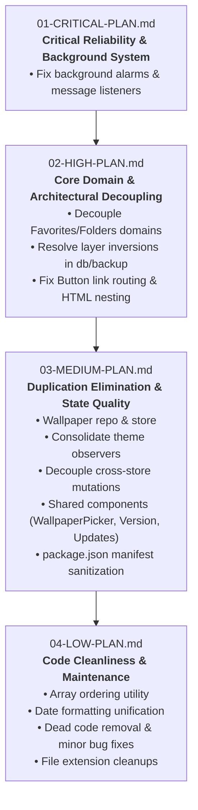

# Aure Homepage — Architecture Remediation Master Plan

This folder contains modular, category-specific remediation plans derived from the comprehensive findings in [**`ARCHITECTURE_AUDIT.md`**](../ARCHITECTURE_AUDIT.md). Each plan is designed to be executed independently in a phased, step-by-step manner.

---

## Remediation Roadmap & Execution Order

To minimize regression risk and preserve application stability, plans must be executed in sequential order:

---

## Plans Index & Status Dashboard

| Plan | Target Severity | Issues Covered | Status | Estimated Effort |
| :--- | :--- | :--- | :--- | :--- |
| [**01-CRITICAL-PLAN.md**](./01-CRITICAL-PLAN.md) | **Critical** | ARCH-001 | `[x] Completed` | 1 hour |
| [**02-HIGH-PLAN.md**](./02-HIGH-PLAN.md) | **High** | ARCH-002, ARCH-003, ARCH-007 | `[x] Completed` | 4–6 hours |
| [**03-MEDIUM-PLAN.md**](./03-MEDIUM-PLAN.md) | **Medium** | ARCH-004, ARCH-005, ARCH-006, ARCH-008, DUP-001, DUP-002, DUP-003, DUP-004, MAINT-001 | `[ ] Ready` | 6–8 hours |
| [**04-LOW-PLAN.md**](./04-LOW-PLAN.md) | **Low / Maint** | DUP-005, REUSE-001, REUSE-002, MAINT-002 | `[ ] Ready` | 2–3 hours |

---

## Execution Protocol

When executing each plan:
1. **Branching:** Work on a dedicated branch per plan (e.g., `refactor/01-critical-fixes`).
2. **Step Verification:** Complete one checklist item at a time and run validation checks (`npm run build`, `npm run lint`).
3. **No Mixed Changes:** Do not mix refactors across plans unless explicitly stated in prerequisites.
4. **Update Status:** Mark items as `[x]` in the respective plan file as tasks are completed.
